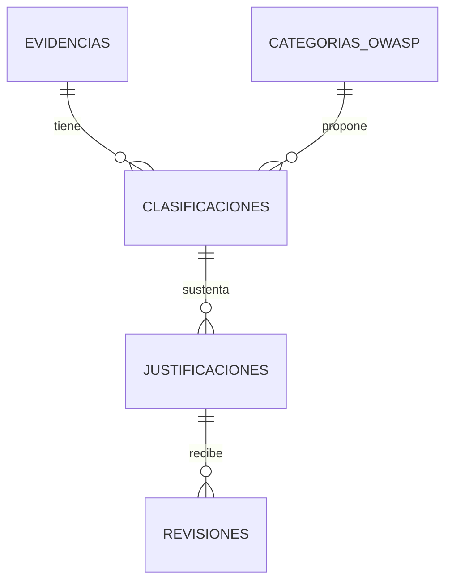

# AUDITORIA · Evidencias y clasificación

Nuevo prototipo local: **FastAPI + Python + React + SQL (SQLite 3)**. Parte sin evidencias, justificaciones ni revisiones. Solo se inicializan las diez categorías OWASP 2025, necesarias para clasificar.

## Ejecutar en XAMPP (configuración principal)

Abrir **http://localhost:8080/AUDITORIA/** con Apache activo. El React compilado está publicado en `index.html` y `assets/`; el adaptador `api.php` ejecuta el contrato REST mediante PHP PDO SQLite. No necesitas iniciar el puerto 8000 ni ejecutar Python para usar esta dirección.

- Requiere `pdo_sqlite` y `mbstring`, disponibles en esta instalación de XAMPP.
- `api.php?path=/evidencias` equivale a `GET /api/evidencias` en FastAPI. El adaptador conserva las FK, versiones, reglas y validaciones del flujo.
- La base local es `data/auditoria.sqlite3`, protegida por `.htaccess`. Las tablas se crean al acceder y solo se carga el catálogo OWASP; no se agregan evidencias de ejemplo.
- No necesita MySQL: el esquema solicitado utiliza SQL de SQLite 3. FastAPI y PHP comparten ese esquema. La base MySQL del prototipo anterior no se modifica.
- Para recompilar React: desde `frontend`, ejecutar `pnpm install --ignore-scripts` y `pnpm build:xampp`. Publica la compilación en la raíz del proyecto.
- Prueba del adaptador: `python tests/smoke_xampp.py` (usa datos temporales propios y los elimina al terminar).

## Ejecutar FastAPI como alternativa y entregable

El código FastAPI de la Tarea 3 se conserva. Su ejecución es opcional; la dirección de trabajo en esta instalación es XAMPP 8080.


Requiere Python 3.10+ y Node.js 20.19+.

```powershell
python -m venv .venv
.\.venv\Scripts\Activate.ps1
python -m pip install -r backend/requirements.txt
cd frontend
npm install
npm run build
cd ..
python run.py
```

Abrir **http://127.0.0.1:8000/**. La API sirve el frontend compilado y usa `data/auditoria.sqlite3`. La carpeta `data` no se expone como contenido web. Cambiar la ubicación con `AUDITORIA_DB` si es necesario. No se conecta a la base MySQL del prototipo anterior ni la modifica.

En esta sesión, las dependencias Python se instalan localmente en `.deps` y el lanzador las reconoce automáticamente. El frontend usa `pnpm-lock.yaml`; con pnpm utilizar `pnpm install --frozen-lockfile --ignore-scripts` y `pnpm build` para reproducir esa instalación.

Para desarrollar con recarga del frontend, iniciar primero `python run.py` y después `npm run dev` en `frontend`. Vite abre el puerto 5173 y reenvía `/api` a FastAPI en 8000. No abrir React directamente mediante Apache: esta versión usa FastAPI.

## Los cinco entregables

| Tarea | Archivos |
|---|---|
| 1 · Esquema SQL con FK y timestamps | `database/schema.sql` |
| 2 · Modelo Python de entidades | `backend/models.py` |
| 3 · API REST RF01, RF02, RF04 y revisión | `backend/main.py`, `backend/classifier.py`, `backend/db.py` |
| 4 · Componente React funcional | `frontend/src/App.jsx`, `frontend/src/api.js` |
| 5 · Exportación CSV de clasificaciones revisadas | `backend/export.py`, `GET /api/exportar.csv` |

## Uso y flujo

1. **Entrada:** escribir evidencia, activo y perfil. Se guarda la evidencia sin inventar hallazgos.
2. **Análisis e hipótesis:** el backend aplica reglas versionadas y muestra el motivo de cada coincidencia. Cero coincidencias requiere datos adicionales o clasificación manual. Varias coincidencias no se fuerzan a una respuesta única.
3. **Contraste:** comparar el criterio de la categoría elegida con una categoría cercana y escribir las diferencias.
4. **Clasificación:** guardar explícitamente la categoría candidata. También se puede seleccionar una categoría manualmente.
5. **Justificación:** registrar autor, argumento, contraste, impacto, dato faltante, política institucional, referencia ASVS y prueba WSTG. Si una referencia no fue proporcionada, dejar esa limitación explícita.
6. **Revisión humana:** un revisor distinto del autor registra aprobación u observación. Es una simulación académica, no autenticación real de personas.
7. **Exportación:** descargar CSV UTF-8 con BOM y separador `;`, compatible con Excel. Incluye únicamente la revisión más reciente de la versión actual, aprobada u observada, y siempre indica su decisión. No exporta borradores ni reutiliza aprobaciones de versiones anteriores.

Una corrección crea otra clasificación o justificación; conserva el historial y exige nueva revisión para que se exporte como revisada. No existen endpoints para borrar o sobrescribir el historial.

## API

Documentación interactiva: **http://127.0.0.1:8000/docs**.

| Método y ruta | Función |
|---|---|
| GET `/api/categorias` | Catálogo de criterios y categorías próximas |
| POST `/api/evidencias` | RF01: `{texto, activo, perfil}` |
| GET `/api/evidencias` | Matriz del estado actual |
| GET `/api/evidencias/{id}/hipotesis` | RF02/RF03: candidatos, criterio, motivo, contraste y versión del motor |
| POST `/api/evidencias/{id}/clasificaciones` | Guardar `{categoria_id}` candidata |
| POST `/api/clasificaciones/{id}/justificaciones` | RF04: guardar justificación y contexto |
| POST `/api/justificaciones/{id}/revisiones` | RF05: `{revisor, decision, observaciones}` |
| GET `/api/evidencias/{id}/historial` | Versiones de clasificaciones, justificaciones y revisiones |
| GET `/api/exportar.csv` | RF06: matriz revisada |

## Arquitectura y relaciones

React → API FastAPI → reglas explicables + repositorio SQLite → revisión humana → exportación.



Las FK están activadas en cada conexión. Los timestamps son UTC; los registros de clasificación, justificación y revisión son versiones insertadas, no editadas. La tabla de evidencias incluye `updated_at` y un trigger para futuras actualizaciones. La selección de la versión actual utiliza el ID creciente, no depende del orden de los timestamps.

## Seguridad y límites

- Entradas validadas y limitadas, consultas SQL parametrizadas, protección de fórmulas en CSV y representación escapada por React.
- No hay llamadas a IA ni servicios externos para clasificar. Las reglas son hipótesis auditables, no una detección exhaustiva de vulnerabilidades.
- Evitar datos personales, tokens y contraseñas. Usar evidencia anonimizada: tanto la base como el CSV contienen el texto ingresado. La aplicación no afirma anonimizarlo automáticamente.
- Prototipo vinculado a loopback, sin autenticación ni roles reales. El nombre del revisor y la comprobación de que sea distinto del autor no prueban identidad. Antes de producción: autenticación, autorización por proyecto/rol, cifrado, límites de uso, retención y protección del historial frente a administradores.
- Sin coincidencias no significa seguridad. Exigir contexto, contraste y pruebas para reducir falsos positivos/negativos. La aprobación se refiere a la clasificación de una ficha, no a la certificación del sistema.
- La versión actual incorpora análisis estático ZIP en XAMPP además de las cinco tareas. No incorpora análisis por enlace ni generación PDF.

## Referencias

- Clasificación: [OWASP Top 10:2025](https://top10.owasp.org/2025/).
- Verificación: [ASVS](https://owasp.org/www-project-application-security-verification-standard/). Registrar la versión y requisito aplicables; el prototipo no inventa IDs.
- Pruebas: [WSTG](https://owasp.org/www-project-web-security-testing-guide/). Registrar precondiciones y resultados esperados.
- Política institucional: aportada por el usuario, con documento, versión y criterio contextual.

## Pruebas

```powershell
python run_tests.py
```

Las pruebas FastAPI usan bases temporales: estado vacío, claves foráneas, hipótesis únicas/ambiguas/insuficientes, validación, origen de peticiones, revisión por versión, conservación del historial, exclusión de borradores y seguridad CSV. No crean datos de prueba en la base real.

## Nombre del sistema, ZIP y papelera

En XAMPP, comenzar en «¿Qué sistema vas a evaluar?»: registrar un nombre (por ejemplo Tienda tecnológica) y seleccionarlo. El nombre identifica el proyecto; el análisis requiere subir su código fuente ZIP. Las señales se convierten en evidencias con categoría candidata, pendientes de justificación y revisión; no se inventan justificaciones ni aprobaciones. El selector filtra matriz y CSV por sistema.

Las evidencias anteriores se conservan como «Sin sistema asignado». El desplegable de cada fila permite asignarlas a un sistema registrado. «Quitar evidencia» cambia archived_at sin borrar relaciones ni revisiones. «Papelera / restaurar» muestra esas evidencias y permite restaurarlas. Las evidencias archivadas no aparecen en la matriz activa ni se exportan.

La carga ZIP se ejecuta exclusivamente en el adaptador PHP/XAMPP: hasta 20 MB comprimidos, 50 MB descomprimidos, 500 archivos de código (512 KB por archivo), 5000 entradas y 100 señales. Omite vendor, node_modules, .git, dist y build. Reglas de PHP y algunas señales de JavaScript, sin análisis completo de flujo de datos, autenticación ni lógica de negocio. No extrae ni ejecuta el proyecto; el temporal se elimina y no se guardan fragmentos de código. Los nombres de rutas y hallazgos sí se guardan. Un resultado sin coincidencias no certifica ausencia de vulnerabilidades; el resumen indica recuentos y límites alcanzados. Cada nueva carga crea un análisis independiente y puede repetir señales de una carga anterior.

FastAPI mantiene el flujo textual y agrega sistemas, asignación y papelera; su endpoint de carga ZIP no está implementado. La interfaz de trabajo para ZIP es http://localhost:8080/AUDITORIA/ . Pruebas del nuevo flujo: python tests/smoke_projects.py .

## Mejoras de operación y trazabilidad

- Resumen del sistema seleccionado y porcentaje de fichas con revisión humana; no es una puntuación de seguridad.
- Filtros de matriz por categoría OWASP, estado y texto.
- «Ver historial» muestra las versiones de clasificación, justificación y revisión por evidencia.
- Selector del historial de cargas ZIP por sistema, con alcance, recuentos y huella SHA-256.
- Repetir el mismo ZIP en el mismo sistema recupera el análisis existente y no vuelve a insertar sus hallazgos. No se evita una coincidencia repetida entre ZIP distintos ni se restauran automáticamente hallazgos archivados.
- Las evidencias en papelera se pueden restaurar; el backend rechaza clasificarlas o justificarlas mientras permanezcan archivadas.
- El frontend cancela la aplicación de respuestas antiguas al cambiar de sistema o de vista de papelera, muestra errores de respuesta y estados de carga.

Estas mejoras del analizador y deduplicación se ejecutan en XAMPP/PHP. FastAPI conserva su contrato textual alternativo; no reemplaza el adaptador de carga ZIP.

La matriz inicia en «Solo el análisis ZIP seleccionado». Cada evidencia automática conserva analisis_id, ubicación y recomendación, y la exportación usa ese mismo alcance. Las evidencias manuales se consultan en una vista separada; las asociaciones históricas solo se recuperan si son inequívocas, sin asignar registros por semejanza.

El formulario de respuesta se muestra debajo de la matriz. Seleccionar la evidencia en el desplegable o pulsar Responder. Guardar justificación antes de registrar revisión. Si la misma persona cumple ambos papeles, debe marcar Autoevaluación; la revisión y el CSV conservan ese indicador. No constituye autenticación de un docente.

## Análisis por enlace en XAMPP

La interfaz ofrece tres fuentes: enlace, ZIP y «Registrar una falla observada». El endpoint PHP es POST `/sistemas/{id}/analizar-url`, con `{url, autorizacion: "1"}`. La autorización del propietario se confirma en la interfaz; el prototipo no verifica titularidad. Si no hay sistema seleccionado, se crea con el dominio del enlace. Acepta Render, AWS, Vercel y cualquier dominio público accesible por HTTP/HTTPS; no depende de la extensión del dominio.

Revisión pasiva de una página HTML y hasta tres redirecciones: HTTPS, CSP, nosniff, restricciones de marcos, HSTS en HTTPS, atributos de cookies y patrones de errores PHP. Cada redirección valida de nuevo el destino y fija su IP resuelta para la conexión. Se bloquean destinos privados/reservados salvo localhost para pruebas. Se permiten puertos públicos 80/443 y localhost 80/443/8080; requiere resolución IPv4. No hay navegación autenticada, envío de formularios ni pruebas de explotación. El límite de contenido es 2 MB, cabeceras 64 KB y la conexión tiene límites de tiempo. Los errores HTTP no se convierten en un análisis exitoso ni en falsas vulnerabilidades.

La validación TLS está activa. Si XAMPP no tiene configurado curl.cainfo, se busca un paquete CA disponible localmente (XAMPP o certifi) o AUDITORIA_CA_BUNDLE. Nunca se desactiva la validación del certificado para lograr que una conexión funcione.

No se guardan HTML, valores de cookies ni parámetros de consulta del enlace. Los hallazgos de cabeceras son señales de endurecimiento contextual, no pruebas de explotación. Un enlace con cero señales no certifica seguridad. Las URL se almacenan con su dominio/ruta, sin query ni fragmento, y se vinculan al análisis para separar su matriz de otros análisis.

Para conservar compatibilidad, los análisis URL se almacenan en la tabla histórica `analisis_zip`; `resultado.origin="url"` distingue su origen. El frontend muestra URL y respuestas HTTP en lugar de ZIP y archivos. Repetir una URL ejecuta una revisión nueva; la deduplicación de contenido aplica únicamente a ZIP. FastAPI alternativo no implementa el analizador URL; esta función se ejecuta en XAMPP.

Prueba local sin servicios externos: `python tests/smoke_url.py`. Comprueba consentimiento, protocolos y redes restringidas, respuesta HTML, asociación a la matriz y exclusión de parámetros de consulta. Los datos temporales se limpian al finalizar.

El menú lateral cuenta con accesos funcionales a evaluación, problemas, respuesta, papelera y referencias; se adapta a pantalla pequeña. Los resultados priorizan tarjetas de problemas potenciales con ubicación, observación, impacto pendiente y recomendación, seguidas de la matriz detallada. El cuadro RF01–RF06 queda después del trabajo de revisión como referencia académica.
